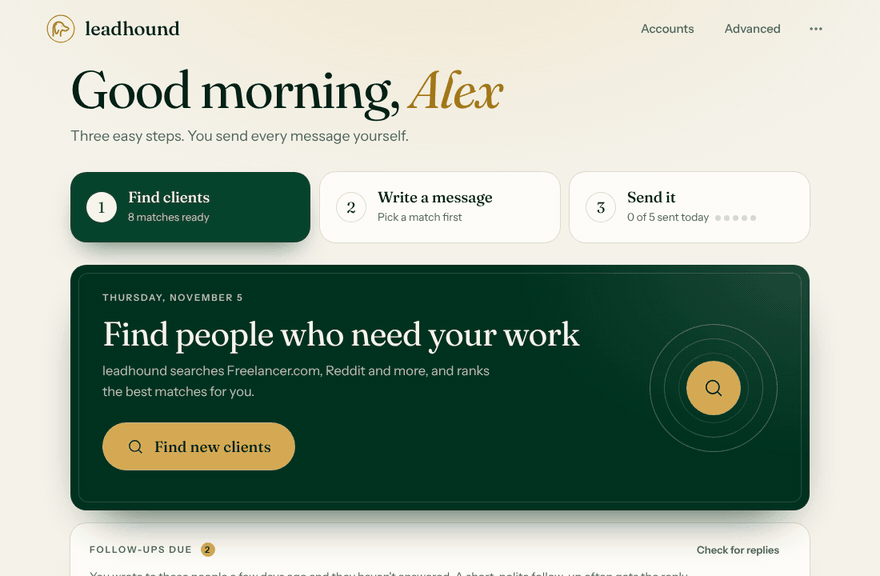
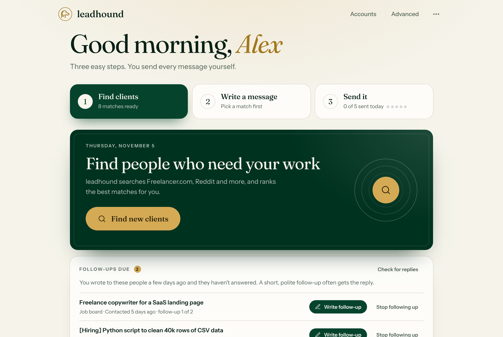
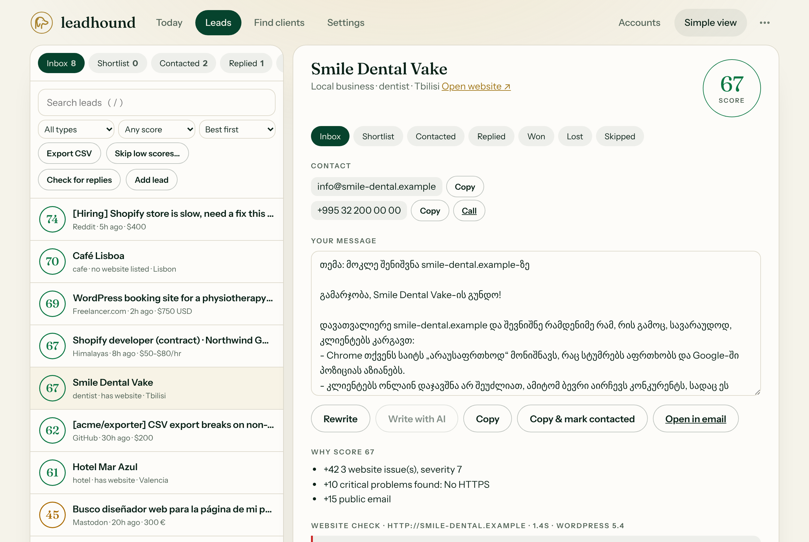
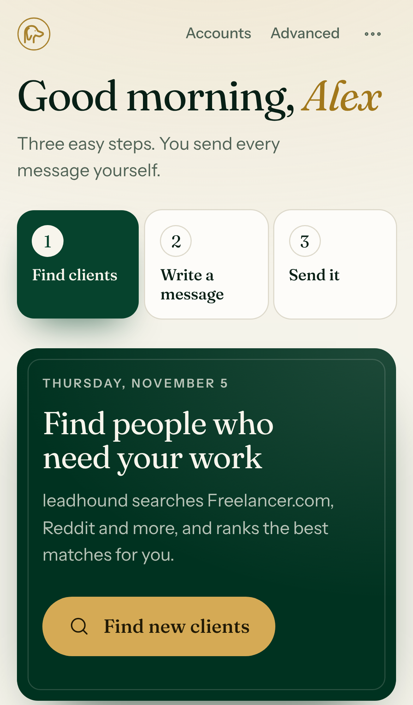

<p align="center"></p>
<h1 align="center">leadhound</h1>

<p align="center"><b>Find freelance clients anywhere in the world, by live intent, not stale contact lists.</b><br>
Free, open source and local-first. Your leads never leave your computer.</p>

<p align="center">
<a href="https://pypi.org/project/leadhound/"></a>
<a href="https://github.com/kalidatuna/leadhound/actions/workflows/test.yml"></a>


<a href="LICENSE"></a>
</p>

<p align="center"><a href="https://kalidatuna.github.io/leadhound/">Website</a> · <a href="#install">Install</a> · <a href="#try-it-in-10-seconds">Try the demo</a> · <a href="CHANGELOG.md">What's new</a></p>

<p align="center"></p>

## Try it in 10 seconds

```bash
pipx run leadhound demo
```

The demo opens the app with made-up sample leads in its own folder (sending is off), so you can click through
everything before you set anything up. `uvx leadhound demo` works too.

## What it does

Most lead tools sell you a database of names, then you cold-email strangers who never asked for anything. leadhound does the opposite. It finds people and businesses that need your kind of work **right now**, shows why each one fits, and drafts a first message from that evidence, in the client's own language. You review it and send it yourself.

It works for **any freelancer**: developers, designers, writers, translators, marketers, video editors, photographers, virtual assistants, data and AI people, voice artists and bookkeepers.

- **Live intent.** New client projects on Freelancer.com, plus hiring posts on Reddit, Hacker News, Mastodon, job boards and paid GitHub issues.
- **Local businesses in any country.** Finds shops, clinics, cafes and trades anywhere with OpenStreetMap. It checks their websites and writes the pitch in the business's language.
- **Evidence-based pitch.** The website check finds problems an owner understands, such as "Chrome marks your site Not secure" or "customers can't book online". The message cites only those.
- **Explainable scores.** Every lead gets a 0–100 score with a line-by-line reason list. No black box.
- **11 languages.** English, Español, Português, Français, Deutsch, Русский, ქართული, Türkçe, العربية, हिन्दी and 中文, for both the app and the messages.
- **Follow-ups that don't slip.** Leads you wrote to who haven't answered come back after a few days with a short follow-up ready.
- **Learns what works for you.** Reply rates per source, with tips that show the numbers behind them.
- **Private and free.** Your data stays on your computer. No account, no tracking, no API key needed. Zero dependencies.

| Today | A lead, with reasons and website findings | On your phone |
|---|---|---|
|  |  |  |

## Install

| Your computer | Do this |
|---|---|
| **Windows** | Open PowerShell and paste: `irm https://raw.githubusercontent.com/kalidatuna/leadhound/main/install.ps1 \| iex` |
| **macOS / Linux** | Open Terminal and paste: `curl -fsSL https://raw.githubusercontent.com/kalidatuna/leadhound/main/install.sh \| sh` |
| **No Python, no terminal** | Download the app for your system from [Releases](https://github.com/kalidatuna/leadhound/releases/latest), unzip it and double-click `leadhound`. |

The installer puts everything in your user folder (no admin rights), adds a desktop icon and opens the app. After that, double-click the icon (no terminal window opens) or type `leadhound`.

The downloaded app files are not code-signed yet. The first time you open one, Windows shows "Windows protected your PC": click **More info**, then **Run anyway**. On macOS, right-click the file and choose **Open**.

<details><summary>Other ways to install</summary>

```bash
pipx install git+https://github.com/kalidatuna/leadhound   # then: leadhound
```

Or clone the repo and run `python -m leadhound`. Python 3.10 or newer is needed.
</details>

## How to use it (3 steps)

1. **Open leadhound** (desktop icon, or type `leadhound`). The first time, pick your kind of work, such as *Translator*, and click **Save and start searching**.
2. **Click Write message** on a match. A message is ready in the client's language. Read it and change anything you like.
3. **Send it.** Pick **Send via** (email, WhatsApp, Reddit, the project page...) and click the gold button. Connected accounts send for you; the others open with your message ready. The next match moves up.

That is the whole simple view. **Find new clients** searches again whenever you like. **Not for me** hides a match. **Quit** closes leadhound. Double-clicking the icon twice just reopens the same window.

Everything else lives behind the **Advanced** button: the full list with filters and stages, detailed searches, settings, export and updates. Light or dark: the ⋯ menu has the theme and the language.

## After you write: follow-ups, replies and what works

- **Follow-ups.** After a few days without a reply (you choose 2–14), the lead shows under **Follow-ups due** on Today with a short, polite follow-up already written in the client's language. Two by default; the last one says you won't write again. **Stop following up** ends it.
- **Reply detection** *(Pro)*. **Check for replies** looks in the inbox of the email account you connected, read-only, for answers from leads you wrote to, and moves them to *Replied*. It never downloads, marks, moves or deletes mail.
- **What works.** After three messages, Today shows the reply rate per source and plain tips such as "No replies from Reddit after 10 messages" or "Leads scoring 60+ replied 30% of the time, others 0%".
- **Proof of your work.** In Settings, add a few lines like `wordpress, booking: Rebuilt a clinic's site with online booking: https://…`. Each draft adds the one that matches the lead best, and leaves it out when none fits.
- **Alerts.** Desktop notifications when a search finds new matches in the background (free), and *(Pro)* an email to yourself with the best new matches after each automatic search.

## Browser extension

Found a client post or a business website yourself? The extension in [`extension/`](extension/) sends the page to leadhound: **Save this page as a lead** (with any text you selected) or **Check this website**. It only talks to leadhound on your own computer, and you confirm inside the app. You can also paste a link with **Add lead** on the Leads screen.

## Send from your own accounts

Most platforms work right away with no setup: leadhound opens them with your message filled in. Click **Accounts** only if you want leadhound to send for you through your own account. Either way you still press the button on every message: leadhound never sends on its own, and the address always comes from the lead itself, never from the page.

| Platform | How it works |
|---|---|
| **Gmail, Outlook** | Nothing to connect. Opens a new message with the address, subject and text filled in, in the account you are already signed in to. You press Send there. |
| **Email** | Gmail, Outlook or any mail server, with an *app password* (not your normal password). Connecting sends a test email to yourself. |
| **Mastodon** | Direct message, with an access token you create on your server (Preferences, Development, `write:statuses`). |
| **GitHub** | Comment on a paid issue, with a personal access token that can write issues. |
| **Reddit** | Private message, through a *script* app you create at reddit.com/prefs/apps. Reddit limits cold messages, so the cap is 5 a day. |
| **WhatsApp** | Opens a chat with the lead's phone number and your message filled in. Nothing to connect. |
| **Telegram, Freelancer.com** | Copies your message, then opens the chat or the project page so you paste and send. |

Each account has a daily cap (10 for email and Mastodon, 5 for GitHub and Reddit), a pause between sends, and a block on sending to the same lead twice in a row. Logins are saved in `accounts.json` next to your config, readable only by your user. **The file is not encrypted**, so anyone who can read your user folder can read it. Use an app password or a limited token, never your main password, and disconnect to delete a login. Sending to Reddit, Mastodon and GitHub has been tested against local stand-ins, not the live services.

## Free and Pro

**Free has no limits on anything you do yourself**, and needs no account: every source, all your matches, the local business finder, website checks, drafts, follow-ups, sending from your own connected accounts, and AI drafts with your own key (Claude, OpenAI) or a local model.

**Pro** pays for the things that run for you or cost money to provide:

- **leadhound AI**: AI-written messages with no API key.
- **Automatic search** every 6, 12 or 24 hours, with an email of the best new matches.
- **Reply detection**: leadhound checks your inbox and moves leads that answered to *Replied*.

You can try Pro a few times for free, then start a **7-day trial** with an email sign-up (one per person). Pro is a license key checked offline. The sign-up and the hosted AI talk to the seller's license server and send only your email, a device code, and (for AI) the text of the lead. Sellers: see [docs/SELLING.md](docs/SELLING.md).

## Advanced

**Find clients**
- **People hiring right now**: one click searches all your sources. Freelancer.com alone usually brings 50–150 fresh projects in your categories.
- **Local businesses**: type any city in the world, pick business types (more than 70, such as dentists, cafes, plumbers or hotels), choose a distance or **Whole city**. Optionally only show places without a website, and check their sites.
- **Check one website**: paste an address to get the problems found, a ready pitch and the contact details the site publishes.

**Leads**
- The list is ranked best first. A pipeline tracks each lead: Inbox, Shortlist, Contacted, Replied, Won, Lost, Skipped. **NEW** marks what appeared since your last visit.
- Each lead shows why it scored what it did, the original post or website problems, and contact buttons (Copy, Open, Call). **Write with AI** uses Claude, OpenAI or a local Ollama model if you set one up.
- **Add lead** saves a post you found yourself; **Check for replies** looks for answers in your inbox (Pro).
- Every move has an **Undo**. Keyboard: `j`/`k` move, `s` shortlist, `c` contacted, `x` skip, `g` write, `o` open, `/` search. **Skip low scores…** clears weak leads; **Export CSV** gives you a spreadsheet.

**Settings**: app language, message language (automatic = the client's language), your work and skills, proof of your work, currency and minimum budget, follow-up timing, sources, **automatic search** every 6/12/24 hours, alerts, and the optional AI provider. **Updates**: the app tells you when a new version exists and installs it with one click.

## Where leads come from

| Source | What it finds |
|---|---|
| **Freelancer.com** | New client projects in the categories for your work (`Translation`, `Logo-Design`, `WordPress`, ...), worldwide, with budgets in any currency. |
| **Reddit** | `[Hiring]` and "need a ..." posts in r/forhire, r/jobbit, r/hiring and communities for your work (r/HireaWriter, r/DesignJobs, r/HireAnEditor, ...). Competitors' `[For Hire]` posts are dropped. |
| **Hacker News** | `SEEKING FREELANCER` posts and contract roles from the monthly threads. |
| **GitHub** | Open, unassigned issues with bounty labels. Only cash amounts count as **paid bounty**; points don't. Max 3 per owner. |
| **Himalayas** | Remote **contract** roles (not full-time jobs) from himalayas.app, searched by your top 3 skills, with pay when stated. |
| **Mastodon** *(off by default)* | Fediverse posts asking for help, in any language. Worldwide but low-volume. |
| **Job boards** | Any RSS feed. Presets per profession: We Work Remotely, Dribbble, Jobspresso, Authentic Jobs. |
| **Local** | OpenStreetMap businesses near any place, by type, with automatic fallback between map servers. |

Requests in English, Spanish, Portuguese, French, German, Russian, Georgian, Turkish, Italian, Arabic and Chinese are recognised. "I'm looking for work" posts are filtered out in the same languages.

## Website check

The check reads the homepage and up to 8 internal links:

| Severity | Check |
|---|---|
| critical | Site down or erroring, broken HTTPS, no HTTPS, not mobile-friendly, WordPress < 6, Flash |
| costs customers | Slow (> 3 s), copyright 2+ years old, no contact path, no online booking (booking businesses), broken links, mixed content, no title |
| minor | No meta description, no structured data (hurts maps ranking), old jQuery, images without alt text |

It never pitches what it can't verify. If a site blocks automated checks (bot protection), the result is marked **inconclusive**. Only 404/410/5xx count as broken links. The copyright year comes from visible text only. Contact and booking words are recognised in 10+ languages.

## Scoring

| Part | Points |
|---|---|
| Your skills in the title, text or the project's skill tags | up to 35 |
| Hiring intent: client project, `[Hiring]`, "looking to hire", "paid", budget, urgency (any language) | up to 25 |
| Budget, scaled by size in USD, or −15 if below your minimum (compared in your currency) | −15 to +15 |
| Fresh: < 24 h / < 3 d / < 7 d | 15 / 10 / 5 |
| Public email, or another contact path | 10 / 5 |
| No replies yet / crowded | +5 / −5 |
| Each phrase from your "no thanks" list | −30 |

Leads with no skill match are capped at 45. Local businesses score on website problems (or no website), plus public contact details.

## Run it online (your own private copy)

To use leadhound from your phone or any computer, run your own copy on a server. It then asks for a password.

- **Render** (one click): [Deploy to Render](https://render.com/deploy?repo=https://github.com/kalidatuna/leadhound). It generates the password for you; find it under *Environment*. Keeping data between restarts needs Render's paid disk, about 7 USD/month.
- **Any server with Docker**:
  ```bash
  docker run -d -p 8787:8787 -e LEADHOUND_PASSWORD='a-long-password' -v leadhound:/data ghcr.io/kalidatuna/leadhound
  ```
  Or use the included `docker-compose.yml`. Put it behind HTTPS (Caddy, Cloudflare Tunnel, ...) when it is on the internet.
- **Railway / Fly.io**: deploy this repository's `Dockerfile`, set `LEADHOUND_PASSWORD`, and mount a volume at `/data`.

Cloud mode is password-protected and rate-limits sign-in attempts (5 wrong passwords, then a 10-minute pause). Sessions use an HttpOnly cookie, and it refuses to check private network addresses. If a proxy sits in front of it (Render, Caddy, Cloudflare), set `LEADHOUND_TRUST_PROXY=1` (the number of proxies you run) so the pause applies to each visitor instead of to the proxy. Some sites, especially Reddit, block data-center IP addresses, so expect fewer Reddit results from a server than from your own computer.

## Privacy and security

- Local mode listens on `127.0.0.1` only, blocks DNS rebinding, and requires a per-run token on every API call. It also sends a strict Content-Security-Policy with no inline scripts. Text from posts and websites is never rendered as HTML.
- Keys (`GITHUB_TOKEN`, `ANTHROPIC_API_KEY`, `OPENAI_API_KEY`) are read from environment variables and never saved to disk.
- Account logins for sending are saved in `accounts.json` (owner-only permissions, not encrypted) and are never sent to the browser. See *Send from your own accounts*.
- Installs and updates come directly from this GitHub repository's release archives.

## Responsible use

- **You send every message.** Personalise it, and never mass-send. Daily caps exist to protect your accounts, not to set a target.
- **Follow outreach law** where you and the recipient are, such as CAN-SPAM, GDPR or ePrivacy. Identify yourself and stop when asked.
- **Check before pitching.** OpenStreetMap can miss websites, so open the site yourself before you send audit findings.
- **Respect the sources.** leadhound identifies itself, rate-limits per site, and only reads public posts and public business listings.

## Terminal commands (optional)

```bash
leadhound scan                                  # search all sources
leadhound local "Lisbon, Portugal" --category cafe,dentist --radius 0 --website no
leadhound list --min-score 60
leadhound draft 12                              # message in the lead's language
leadhound audit https://example.com --booking
leadhound shortcut                              # desktop icon
leadhound serve --cloud                         # server mode (needs LEADHOUND_PASSWORD)
leadhound demo                                  # try it with sample leads (separate folder)
leadhound trends --days 30                      # what clients asked for lately, as a Markdown table
```

## Contributing

Translations, sources, professions and website checks are all welcome. See [CONTRIBUTING.md](CONTRIBUTING.md) and the issues labelled [good first issue](https://github.com/kalidatuna/leadhound/labels/good%20first%20issue). The translations were machine-assisted, so native speakers fixing wording would help a lot: each language is a short JSON file and a short Python file.

```bash
python -m unittest discover -s tests -t tests
```

## License

MIT. Fonts (Fraunces, Instrument Sans) are under the SIL Open Font License, see `leadhound/dashboard/fonts/`. Platform logos come from [Simple Icons](https://simpleicons.org) (CC0) and belong to their owners; they only say which platform a button is for.
